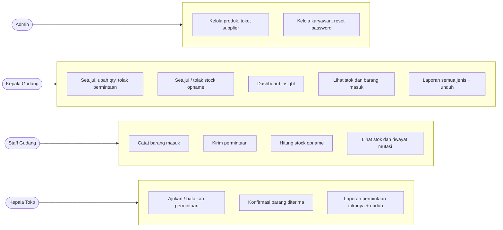
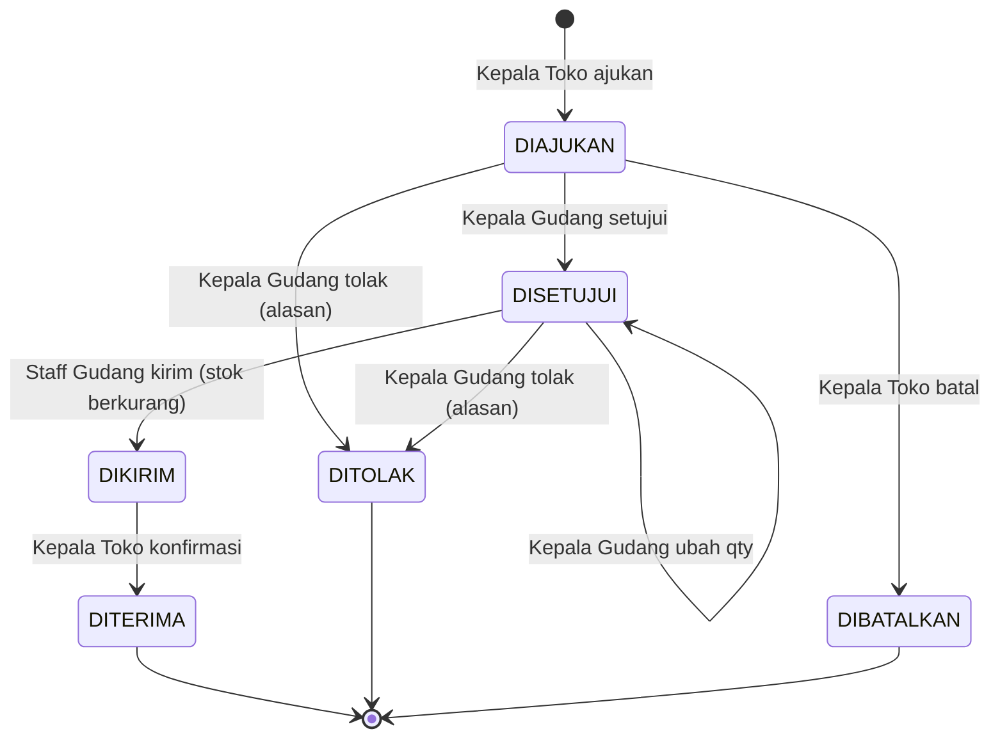

# Software Requirements Specification (SRS) – Stokara

| | |
|---|---|
| Aplikasi | Stokara – sistem inventory gudang |
| Studi kasus | Warehouse Branch Semarang (melayani 3 toko) |
| Versi dokumen | 1.0 – 19 November 2026 |
| Dokumen terkait | [System Design](SYSTEM-DESIGN.md) · [README](../README.md) · [Mockup](mockup/index.html) |

---

## 1. Pendahuluan

### 1.1 Tujuan dokumen

Dokumen ini menjelaskan **apa yang harus dilakukan Stokara**: siapa penggunanya, fitur apa saja, aturan bisnis yang berlaku, dan syarat kualitas (keamanan, tampilan, kinerja). Cara membangunnya dijelaskan di [System Design](SYSTEM-DESIGN.md).

### 1.2 Latar belakang masalah

Gudang cabang melayani permintaan barang dari beberapa toko. Tanpa sistem:

- stok di catatan sering tidak sama dengan stok di rak;
- gudang menyetujui barang yang sebenarnya sudah dijanjikan ke toko lain;
- tidak ada angka yang menunjukkan seberapa baik permintaan toko terpenuhi;
- keputusan kapan memesan ke supplier hanya berdasarkan perkiraan.

### 1.3 Ruang lingkup

Stokara mencakup:

1. data master: produk, toko, supplier, karyawan;
2. stok gudang dan riwayat perubahannya;
3. barang masuk dari supplier;
4. permintaan barang dari toko sampai diterima;
5. stock opname (hitung fisik) dan koreksi stok;
6. dashboard insight: fill rate, safety stock, reorder point, saran restock;
7. laporan periode dengan unduh Excel dan PDF;
8. notifikasi di dalam aplikasi.

**Di luar lingkup:** pemesanan ke supplier (purchase order), harga dan nilai persediaan, penjualan di toko, banyak gudang, dan aplikasi mobile native.

### 1.4 Istilah

| Istilah | Arti |
|---|---|
| Stok fisik | Barang yang benar-benar ada di gudang |
| Stok dipesan | Qty yang sudah disetujui untuk toko tetapi belum dikirim |
| Stok tersedia | Stok fisik − stok dipesan. Hanya angka ini yang boleh disetujui untuk permintaan baru |
| Mutasi stok | Catatan setiap perubahan stok fisik: MASUK, KELUAR, ADJUST |
| Stock opname | Menghitung fisik barang di rak lalu membandingkannya dengan stok di sistem |
| Lead time | Lama barang datang setelah dipesan ke supplier (hari) |
| Fill rate | Persentase qty dikirim terhadap qty diminta toko |
| Safety stock (SS) | Stok pengaman untuk 2 hari permintaan |
| Reorder point (ROP) | Batas stok yang menandakan harus segera memesan ke supplier |
| WIB | Waktu Indonesia Barat (UTC+7) |

---

## 2. Deskripsi umum

### 2.1 Gambaran sistem

Stokara adalah aplikasi web. Pengguna membuka Stokara di browser (laptop atau ponsel), login, lalu melihat menu sesuai perannya. Server Flask berjalan di Vercel dan menyimpan data di MongoDB Atlas.

### 2.2 Pengguna dan role

| Role | Siapa | Tanggung jawab di Stokara |
|---|---|---|
| Admin | Petugas administrasi sistem | Mengelola data master dan akun karyawan |
| Kepala Gudang | Pimpinan gudang | Menyetujui/menolak permintaan, memeriksa opname, memantau insight, membuat laporan |
| Staff Gudang | Petugas gudang | Mencatat barang masuk, mengirim barang, menghitung opname |
| Kepala Toko | Pimpinan toko (satu akun per toko) | Mengajukan permintaan, mengonfirmasi barang diterima, laporan tokonya |

Satu akun punya satu role. Akun Kepala Toko terhubung ke tepat satu toko.

### 2.3 Diagram use case

Semua role: **login, beranda, notifikasi**. Use case khusus setiap role:

### 2.4 Lingkungan operasi

| Bagian | Teknologi |
|---|---|
| Browser | Chrome, Edge, Firefox, Safari versi terbaru; layar laptop dan ponsel |
| Server | Python 3, Flask 3.1, berjalan sebagai serverless function di Vercel |
| Database | MongoDB Atlas (MongoDB 8) |
| Tampilan | Webix 11.4 dan Material Design Icons dari CDN |

### 2.5 Batasan

- Wajib memakai Flask dan MongoDB, dan aplikasi harus di-deploy.
- Minimal satu collection berawalan `master_`.
- Satu gudang (Branch Semarang). Nama branch diatur di `config.py`.
- Paket gratis Vercel dan Atlas: aplikasi harus ringan dan tidak menjalankan proses di latar belakang.

### 2.6 Asumsi

- Setiap toko punya satu Kepala Toko.
- Satuan produk tetap (PCS, PACK, KARTON, BOX, LUSIN). Tidak ada konversi satuan.
- Pengguna mengakses Stokara lewat internet. Unduh Excel/PDF memuat pustaka dari CDN Webix.

---

## 3. Kebutuhan fungsional

Kode **FR** dipakai untuk menelusuri kebutuhan ke test di bagian 7.

### 3.1 Login dan akun (semua role)

| Kode | Kebutuhan |
|---|---|
| FR-01 | Pengguna login dengan username dan password. Username tidak membedakan huruf besar/kecil |
| FR-02 | Username salah dan password salah menampilkan pesan yang **sama** |
| FR-03 | Akun nonaktif tidak bisa login. Akun yang dinonaktifkan saat masih login langsung keluar pada klik berikutnya |
| FR-04 | Session berlaku 8 jam. Pengguna bisa keluar (logout) |
| FR-05 | Setelah login, pengguna hanya melihat menu sesuai rolenya. Halaman/API di luar rolenya ditolak (403) |
| FR-06 | Beranda menampilkan kartu menu beserta jumlah pekerjaan yang menunggu, contoh "2 menunggu persetujuan" |

### 3.2 Data master (Admin)

| Kode | Kebutuhan |
|---|---|
| FR-10 | Admin menambah, mengubah, dan menonaktifkan **toko** (kode, nama, alamat) |
| FR-11 | Admin menambah, mengubah, dan menonaktifkan **supplier** (kode, nama, telepon, alamat) |
| FR-12 | Admin menambah, mengubah, dan menonaktifkan **produk** (kode, nama, kategori, satuan, supplier, lead time 1–60 hari). Stok produk baru = 0 dan tidak bisa diubah dari form produk |
| FR-13 | Admin menambah dan mengubah **karyawan** (username, nama, role, toko untuk Kepala Toko), menonaktifkan, dan mereset password |
| FR-14 | Kode toko/produk/supplier dan username tidak boleh ganda. Kode otomatis huruf besar |
| FR-15 | Admin tidak bisa mengubah role atau menonaktifkan akunnya sendiri |
| FR-16 | Data dinonaktifkan, tidak dihapus, supaya riwayat transaksi tetap utuh |

### 3.3 Stok dan barang masuk

| Kode | Kebutuhan |
|---|---|
| FR-20 | Kepala Gudang dan Staff Gudang melihat stok fisik, dipesan, dan tersedia setiap produk aktif |
| FR-21 | Pencarian produk berdasarkan kode (awalan) atau kata di nama/kategori |
| FR-22 | Riwayat mutasi per produk: waktu, jenis, perubahan, stok akhir, referensi dokumen, petugas |
| FR-23 | Staff Gudang mencatat **barang masuk**: supplier, nomor surat jalan, catatan, daftar produk + qty. Stok fisik bertambah dan tercatat sebagai mutasi MASUK |
| FR-24 | Setiap dokumen diberi nomor otomatis: `BM-YYMMDD-NNNN`, `PRM-…`, `OPN-…` |
| FR-25 | Kepala Toko tidak bisa melihat angka stok gudang |

### 3.4 Permintaan toko

| Kode | Kebutuhan |
|---|---|
| FR-30 | Kepala Toko mengajukan permintaan (daftar produk + qty, catatan). Status DIAJUKAN |
| FR-31 | Kepala Toko membatalkan permintaan yang masih DIAJUKAN |
| FR-32 | Kepala Gudang menyetujui permintaan dengan mengisi qty disetujui per produk. Status DISETUJUI |
| FR-33 | Kepala Gudang mengubah qty disetujui selama status masih DISETUJUI |
| FR-34 | Kepala Gudang menolak permintaan DIAJUKAN atau DISETUJUI dengan **alasan wajib**. Status DITOLAK |
| FR-35 | Staff Gudang mengirim permintaan DISETUJUI. Stok fisik berkurang (mutasi KELUAR). Status DIKIRIM |
| FR-36 | Kepala Toko mengonfirmasi barang diterima. Status DITERIMA |
| FR-37 | Kepala Toko hanya melihat permintaan tokonya. Permintaan toko lain dianggap tidak ada (404) |
| FR-38 | Daftar permintaan bisa difilter status. Detail menampilkan item dan riwayat status |
| FR-39 | Toko melihat label "Qty disesuaikan" jika qty disetujui < qty diminta |

### 3.5 Stock opname

| Kode | Kebutuhan |
|---|---|
| FR-40 | Staff Gudang mengisi hasil hitung fisik per produk. Sistem mencatat stok sistem dan selisihnya. Status MENUNGGU. Stok belum berubah |
| FR-41 | Kepala Gudang menyetujui opname. Stok dikoreksi sebesar selisih (mutasi ADJUST) |
| FR-42 | Kepala Gudang menolak opname dengan alasan wajib. Stok tetap |

### 3.6 Dashboard insight (Kepala Gudang)

| Kode | Kebutuhan |
|---|---|
| FR-50 | Kartu angka: fill rate 30 hari, jumlah produk kritis, perlu restock, permintaan menunggu persetujuan dan menunggu dikirim |
| FR-51 | Grafik tren qty diminta dan dikirim per hari selama 30 hari |
| FR-52 | Fill rate per toko, toko terendah di atas |
| FR-53 | Tabel per produk: status, tersedia, demand per hari, safety stock, ROP, habis dalam, saran restock. Bisa disaring "perlu tindakan" atau semua |

### 3.7 Laporan

| Kode | Kebutuhan |
|---|---|
| FR-60 | Kepala Gudang memilih laporan Permintaan Toko, Mutasi Stok, Barang Masuk, atau Saran Restock |
| FR-61 | Laporan difilter tanggal awal–akhir (WIB, maksimal 366 hari). Laporan permintaan bisa difilter per toko |
| FR-62 | Kepala Toko hanya mendapat laporan permintaan tokonya sendiri |
| FR-63 | Setiap laporan menampilkan ringkasan 4 angka dan tabel dengan halaman |
| FR-64 | Laporan bisa diunduh sebagai **Excel** dan **PDF** berisi judul, periode, ringkasan, nama pencetak, dan semua baris |

### 3.8 Notifikasi

| Kode | Kebutuhan |
|---|---|
| FR-70 | Lonceng di header menampilkan jumlah notifikasi belum dibaca dan 20 notifikasi terbaru |
| FR-71 | Notifikasi dikirim otomatis pada kejadian di tabel bawah. Klik notifikasi membuka dokumennya |
| FR-72 | Pengguna bisa menandai semua notifikasi sudah dibaca. Status baca dicatat per pengguna |

| Kejadian | Penerima |
|---|---|
| Permintaan baru, permintaan dibatalkan | Kepala Gudang |
| Permintaan disetujui | Kepala Toko (tokonya) dan Staff Gudang |
| Qty disetujui diubah, permintaan ditolak, permintaan dikirim | Kepala Toko (tokonya) |
| Opname baru | Kepala Gudang |
| Opname disetujui atau ditolak | Staff Gudang |

---

## 4. Aturan bisnis

| Kode | Aturan |
|---|---|
| BR-01 | Stok tersedia = stok fisik − total qty disetujui yang belum dikirim |
| BR-02 | 0 ≤ qty disetujui ≤ qty diminta, dan total qty disetujui ≤ stok tersedia saat disetujui |
| BR-03 | Menyetujui dengan semua qty 0 tidak boleh. Gunakan Tolak |
| BR-04 | **Tidak ada pengiriman sebagian.** Qty dikirim = qty disetujui. Kalau stok fisik kurang saat dikirim, pengiriman ditolak seluruhnya |
| BR-05 | Batal hanya dari DIAJUKAN, oleh Kepala Toko. Tolak dari DIAJUKAN atau DISETUJUI, oleh Kepala Gudang |
| BR-06 | Setiap perubahan status hanya berhasil jika statusnya masih sesuai (mencegah klik ganda dan dua orang memproses bersamaan) |
| BR-07 | Stok fisik tidak pernah negatif |
| BR-08 | Stok fisik hanya berubah lewat barang masuk, pengiriman, dan opname disetujui. Setiap perubahan tercatat di mutasi stok |
| BR-09 | Selisih opname = stok hitung − stok sistem. Yang dikoreksi adalah **selisihnya**, bukan menimpa stok dengan angka hitung |
| BR-10 | Satu produk tidak boleh ada di dua opname yang sama-sama MENUNGGU |
| BR-11 | Insight memakai permintaan 30 hari terakhir. Rumus di bagian 4.1 |
| BR-12 | Fill rate hanya menghitung permintaan DIKIRIM, DITERIMA, dan DITOLAK. DITOLAK dihitung dikirim 0. DIBATALKAN tidak dihitung |
| BR-13 | Waktu disimpan dalam UTC dan ditampilkan dalam WIB |

### 4.1 Rumus insight

| Nilai | Rumus |
|---|---|
| Demand per hari | qty diminta 30 hari (kecuali Dibatalkan) ÷ 30 |
| Safety stock | ⌈demand × 2⌉ |
| Reorder point | ⌈demand × lead time + safety stock⌉ |
| Habis dalam | tersedia ÷ demand (hari) |
| Saran restock | maks(0, ⌈demand × (lead time + 7) − tersedia⌉) |
| Status | Kritis: tersedia ≤ SS · Perlu restock: tersedia ≤ ROP · Aman: tersedia > ROP · Tidak ada permintaan: demand = 0 |

Contoh lengkap ada di [README](../README.md#rumus-insight-dashboard-dan-laporan-saran-restock).

### 4.2 Diagram status permintaan

---

## 5. Kebutuhan non-fungsional

### 5.1 Keamanan

| Kode | Kebutuhan |
|---|---|
| NFR-01 | Password disimpan sebagai hash (scrypt), tidak pernah disimpan atau dikirim dalam bentuk asli |
| NFR-02 | Session cookie: HttpOnly, SameSite=Lax, Secure (HTTPS) di server, berlaku 8 jam |
| NFR-03 | Setiap route memeriksa login dan role di server, bukan hanya menyembunyikan menu |
| NFR-04 | Semua input divalidasi tipe, panjang, dan formatnya. Key JSON yang tidak dikenal ditolak |
| NFR-05 | Input berupa objek seperti `{"$ne": ""}` ditolak (mencegah NoSQL injection) |
| NFR-06 | Teks dari pengguna ditampilkan sebagai teks biasa, bukan HTML (mencegah XSS) |
| NFR-07 | Rahasia (SECRET_KEY, MONGO_URI, password demo) hanya di environment variable, tidak di repository |
| NFR-08 | Pesan error tidak membocorkan detail sistem. Halaman error 403/404/500 yang rapi |

### 5.2 Konsistensi data

| Kode | Kebutuhan |
|---|---|
| NFR-10 | Perubahan stok memakai operasi atomik database (syarat + perubahan dalam satu langkah) |
| NFR-11 | Unique index di database sebagai pengaman terakhir terhadap kode, username, dan nomor dokumen ganda |
| NFR-12 | Dokumen transaksi menyimpan salinan kode/nama produk, supaya dokumen lama tetap terbaca walau master diubah |

### 5.3 Tampilan dan kegunaan

| Kode | Kebutuhan |
|---|---|
| NFR-20 | Bahasa Indonesia, format angka Indonesia (1.558; 86,8%), tanggal WIB |
| NFR-21 | Responsif: di ponsel sidebar menjadi ikon, form tampil layar penuh, kolom tabel menyesuaikan |
| NFR-22 | Aksi penting (tolak, batal, nonaktifkan) meminta konfirmasi |
| NFR-23 | Tampilan mengikuti mockup yang disetujui: warna ungu Stokara, aksen amber |

### 5.4 Kinerja

| Kode | Kebutuhan |
|---|---|
| NFR-30 | Query yang sering dipakai didukung index (composite dan text), terbukti tidak COLLSCAN |
| NFR-31 | Daftar dibatasi jumlahnya (contoh 300 permintaan, 20 notifikasi). Laporan maksimal 366 hari |

### 5.5 Pemeliharaan dan pengujian

| Kode | Kebutuhan |
|---|---|
| NFR-40 | Struktur MVC: model (logika + database), route (controller), template + static (view) |
| NFR-41 | Unit test otomatis dengan database palsu, tidak menyentuh database asli |
| NFR-42 | Rumus insight berupa fungsi murni yang bisa dites tanpa database |

---

## 6. Kebutuhan data

| Collection | Isi | Jenis |
|---|---|---|
| `users` | Akun, hash password, role, toko | Master |
| `master_produk` | Produk, satuan, supplier, lead time, stok fisik | Master |
| `master_toko` | Toko yang dilayani | Master |
| `master_supplier` | Pemasok | Master |
| `barang_masuk` | Dokumen barang masuk + item | Transaksi |
| `permintaan` | Permintaan toko + item + riwayat status | Transaksi |
| `opname` | Hasil hitung fisik + selisih | Transaksi |
| `mutasi_stok` | Setiap perubahan stok fisik | Log |
| `notifikasi` | Notifikasi per role atau per toko | Log |

Bentuk dokumen dan index dijelaskan di [System Design bagian 4](SYSTEM-DESIGN.md#4-desain-database).

### 6.1 Matriks role × fitur

| Fitur | Admin | Kepala Gudang | Staff Gudang | Kepala Toko |
|---|:-:|:-:|:-:|:-:|
| Beranda, notifikasi | ✓ | ✓ | ✓ | ✓ |
| Master produk, toko, supplier, karyawan | ✓ | | | |
| Dashboard insight | | ✓ | | |
| Stok gudang + riwayat | | lihat | lihat | |
| Barang masuk | | lihat | catat | |
| Permintaan: ajukan, batal, terima | | | | ✓ (tokonya) |
| Permintaan: setujui, ubah qty, tolak | | ✓ | | |
| Permintaan: kirim | | | ✓ | |
| Stock opname: hitung | | | ✓ | |
| Stock opname: setujui, tolak | | ✓ | lihat | |
| Laporan | | semua jenis | | permintaan tokonya |

---

## 7. Ketertelusuran kebutuhan ke test

| Kebutuhan | Bukti test |
|---|---|
| FR-01, FR-02, FR-03, FR-04 | `test_auth.py`: `test_login_berhasil`, `test_username_tidak_terdaftar_pesannya_sama`, `test_user_dinonaktifkan_saat_masih_login_langsung_keluar`, `test_logout_menghapus_session` |
| FR-05, NFR-03 | `test_tampilan.py`: menu per role, `test_halaman_dilarang_tampil_403`; `test_permintaan.py::test_hak_akses_aksi_per_role` |
| FR-10 – FR-16 | `test_master.py` (17 test), termasuk `test_admin_tidak_bisa_mengunci_dirinya_sendiri` |
| FR-20 – FR-25 | `test_stok.py`, `test_barang_masuk.py`, `test_permintaan.py::test_toko_tidak_melihat_angka_stok_gudang` |
| FR-30 – FR-39, BR-01 – BR-06 | `test_permintaan.py` (21 test), termasuk `test_tidak_ada_pengiriman_sebagian`, `test_tidak_bisa_dikirim_dua_kali` |
| FR-40 – FR-42, BR-09, BR-10 | `test_opname.py` (11 test) |
| BR-07, NFR-10 | `test_stok.py::test_stok_tidak_bisa_minus`, `test_koreksi_stok_tidak_boleh_membuat_minus` |
| FR-50 – FR-53, BR-11, BR-12 | `test_insight.py` (contoh angka README) |
| FR-60 – FR-63, BR-13 | `test_laporan.py` (20 test), termasuk `test_batas_tanggal_mengikuti_wib` |
| NFR-01, NFR-04, NFR-05 | `test_auth.py`: `test_password_disimpan_dalam_bentuk_hash`, `test_injeksi_nosql_ditolak`, `test_key_tidak_dikenal_ditolak` |
| NFR-11 | `test_seed_dan_index.py::test_index_unique_menolak_kode_ganda` |

FR-64 (unduhan Excel/PDF) dan NFR-21 (tampilan ponsel) diuji manual di browser. Catatannya ada di [docs/belajar/10-laporan.md](belajar/10-laporan.md).

---

## 8. Pemenuhan ketentuan tugas

| Ketentuan | Bagian dokumen |
|---|---|
| Flask, MongoDB, deploy | 2.4, [System Design 1 dan 11](SYSTEM-DESIGN.md) |
| Authentication, authorization | FR-01 – FR-05, NFR-01 – NFR-03 |
| Validasi dan sanitasi | NFR-04 – NFR-06 |
| Multi user / multi role | 2.2, 6.1 |
| Collection `master_*` | 6 |
| Webix, responsive | NFR-21, NFR-23 |
| Indexing (text, composite) | NFR-30, [System Design 4.2](SYSTEM-DESIGN.md#42-index) |
| Unit testing | NFR-41, 7 |
