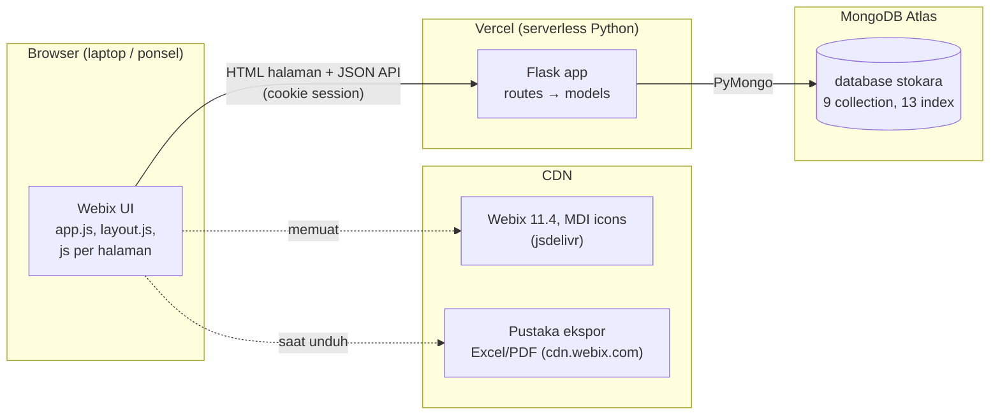
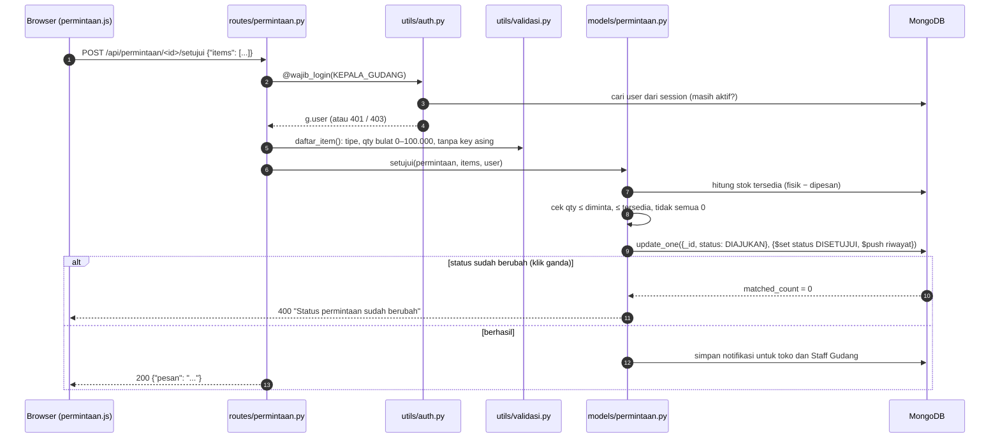
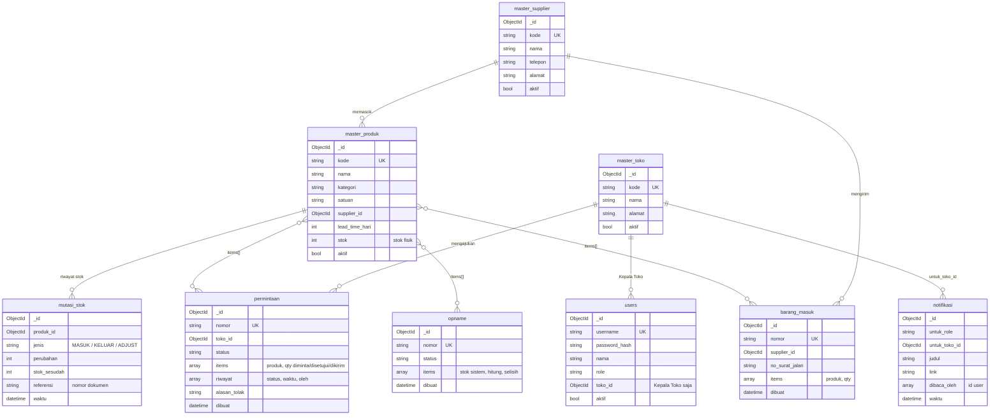
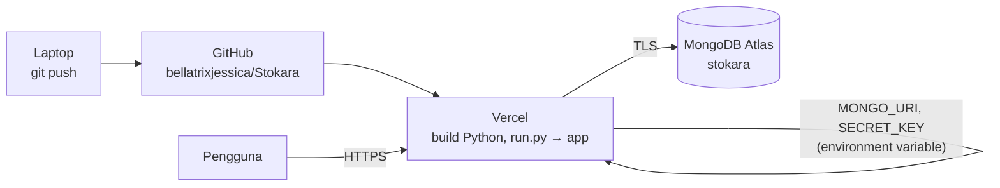

# System Design – Stokara

| | |
|---|---|
| Versi dokumen | 1.0 – 19 November 2026 |
| Dokumen terkait | [SRS](SRS.md) (apa yang dibuat) · [README](../README.md) (cara menjalankan) |

Dokumen ini menjelaskan **bagaimana Stokara dibangun**: arsitektur, struktur kode, database, API, keamanan, dan deploy.

---

## 1. Arsitektur



Pembagian kerja:

| Bagian | Tugas |
|---|---|
| **Browser (Webix)** | Menyusun tampilan (tabel, form, grafik), memanggil API, menampilkan pesan. Tidak menyimpan aturan bisnis |
| **Flask** | Login dan role, validasi input, **semua aturan bisnis**, perhitungan insight, isi laporan |
| **MongoDB Atlas** | Menyimpan data, menjamin keunikan (unique index), operasi stok atomik |

Pola halaman: Flask mengirim kerangka HTML (`halaman.html`) berisi data awal (`DATA`: pengguna, menu). Isi halaman dibuat oleh file JavaScript Webix halaman itu, lalu data diambil lewat API JSON (`/api/...`).

## 2. Struktur kode (MVC)

```
app/
├── __init__.py        create_app(): baca config, sambung database, daftar 13 blueprint, error handler
├── db.py              init_db(): MongoClient (Atlas) atau mongomock (test); get_db()
├── models/            MODEL: logika bisnis + query MongoDB
│   ├── user.py, toko.py, supplier.py, produk.py      data master
│   ├── stok.py                                        3 pintu perubahan stok + mutasi
│   ├── barang_masuk.py, permintaan.py, opname.py      transaksi
│   ├── insight.py                                     rumus + aggregation pipeline
│   ├── laporan.py, beranda.py, notifikasi.py          laporan, kartu beranda, lonceng
│   └── indeks.py                                      daftar 13 index
├── routes/            CONTROLLER: URL, cek role, validasi, panggil model, kirim JSON
├── templates/         VIEW: base.html, login.html, halaman.html, error.html
├── static/            VIEW: css/app.css, img/logo-stokara.svg, js/ (Webix per halaman)
└── utils/
    ├── auth.py        @wajib_login(*role)
    ├── validasi.py    teks(), kode(), angka_bulat(), tanggal(), daftar_item(), ...
    ├── tampilan.py    MENU per role, render_halaman(), halaman_error()
    ├── data.py        ke_json(): ObjectId/datetime → teks
    ├── waktu.py       sekarang() UTC, WIB
    └── nomor.py       buat_nomor(): PRM-261119-0001
```

Aturan pembagian: **route tidak berisi aturan bisnis**, dan **model tidak tahu soal HTTP**. Route hanya menerima, memeriksa, dan meneruskan. Karena itu aturan bisnis bisa dites langsung di model.

### 2.1 Alur satu request

Contoh: Kepala Gudang menyetujui permintaan.



## 3. Halaman dan menu

| Halaman | URL | Role | File JS |
|---|---|---|---|
| Login | `/login` | – | `login.js` |
| Beranda | `/beranda` | semua | `beranda.js` |
| Dashboard | `/dashboard` | Kepala Gudang | `gudang/dashboard.js` |
| Permintaan Toko | `/permintaan` | Kepala Gudang, Staff Gudang | `permintaan_bersama.js` + `gudang/permintaan.js` |
| Permintaan Barang | `/permintaan-saya` | Kepala Toko | `permintaan_bersama.js` + `toko/permintaan.js` |
| Stok Gudang | `/stok` | Kepala Gudang, Staff Gudang | `gudang/stok.js` |
| Barang Masuk | `/barang-masuk` | Kepala Gudang, Staff Gudang | `gudang/barang_masuk.js` |
| Stock Opname | `/opname` | Kepala Gudang, Staff Gudang | `gudang/opname.js` |
| Laporan | `/laporan` | Kepala Gudang, Kepala Toko | `permintaan_bersama.js` + `laporan.js` |
| Produk, Toko, Supplier, Karyawan | `/master/...` | Admin | `admin/*.js` |

Menu di sidebar dan kartu beranda dibuat dari satu daftar `MENU` di `utils/tampilan.py`, jadi menu dan hak akses tidak bisa berbeda.

---

## 4. Desain database

### 4.1 Collection dan relasi



Keputusan desain:

- **Item disimpan di dalam dokumen (embedded array)**, bukan collection terpisah. Satu permintaan selalu dibaca bersama item-nya, dan item tidak pernah dipakai tanpa dokumennya. Ini cara MongoDB yang wajar dan membuat perubahan satu dokumen bersifat atomik.
- **Kode, nama, dan satuan produk ikut disalin** ke item dan mutasi. Kalau Admin mengubah nama produk, dokumen lama tetap terbaca seperti saat dibuat.
- **Nama toko/supplier ikut disalin** ke dokumen transaksi, jadi daftar tidak perlu join.
- **Data master dinonaktifkan (`aktif: false`), tidak dihapus**, supaya referensi di transaksi lama tetap valid.
- **Stok fisik ada di `master_produk.stok`**, bukan dihitung ulang dari mutasi setiap kali dibaca. Mutasi adalah buktinya: stok = jumlah semua mutasi (dicek di test data contoh).
- **Waktu disimpan UTC** (`tz_aware=True`), diubah ke WIB di browser atau saat membuat nomor dokumen dan laporan.

### 4.2 Index

| Collection | Nama index | Field | Jenis | Untuk |
|---|---|---|---|---|
| users | `username_unik` | username | unique | login, cegah username ganda |
| master_produk | `kode_produk_unik` | kode | unique | cegah kode ganda, cari kode |
| master_toko | `kode_toko_unik` | kode | unique | cegah kode ganda |
| master_supplier | `kode_supplier_unik` | kode | unique | cegah kode ganda |
| permintaan | `nomor_permintaan_unik` | nomor | unique | nomor dokumen tidak ganda |
| barang_masuk | `nomor_barang_masuk_unik` | nomor | unique | nomor dokumen tidak ganda |
| opname | `nomor_opname_unik` | nomor | unique | nomor dokumen tidak ganda |
| permintaan | `toko_status_tanggal` | toko_id, status, dibuat ↓ | composite | daftar Kepala Toko |
| permintaan | `status_tanggal` | status, dibuat ↓ | composite | daftar gudang, dashboard, beranda |
| mutasi_stok | `produk_waktu` | produk_id, waktu ↓ | composite | riwayat stok satu produk |
| notifikasi | `role_waktu` | untuk_role, waktu ↓ | composite | lonceng Kepala Gudang / Staff Gudang |
| notifikasi | `toko_waktu` | untuk_toko_id, waktu ↓ | composite | lonceng Kepala Toko |
| master_produk | `cari_produk` | nama (bobot 3), kategori (bobot 1) | **text** | cari kata di halaman Stok |

Urutan field composite mengikuti query: **field filter dulu, lalu field sort**. Bukti dari `explain()` di Atlas:

```
Permintaan satu toko, status DIKIRIM  → FETCH → IXSCAN (toko_status_tanggal)
Cari kata 'minyak'                    → TEXT_MATCH (cari_produk) → FETCH → IXSCAN (cari_produk)
Produk berkode P-0001                 → EXPRESS_IXSCAN (kode_produk_unik)
```

Index dibuat dengan `python scripts/buat_index.py --cek` (aman diulang).

---

## 5. Logika inti

### 5.1 Stok: tiga pintu, satu catatan

Stok fisik hanya berubah lewat tiga fungsi di `models/stok.py`. Ketiganya mencatat mutasi.

| Fungsi | Dipanggil oleh | Jenis mutasi | Operasi MongoDB |
|---|---|---|---|
| `tambah_stok()` | barang masuk | MASUK | `find_one_and_update({_id}, {$inc: {stok: +qty}})` |
| `kurangi_stok()` | pengiriman | KELUAR | `find_one_and_update({_id, stok: {$gte: qty}}, {$inc: {stok: -qty}})` |
| `koreksi_stok()` | opname disetujui | ADJUST | sama, syarat `$gte` hanya jika selisih negatif |

Syarat `stok >= qty` dan pengurangannya dikerjakan database **dalam satu langkah**. Kalau dua Staff Gudang mengirim bersamaan dan stok hanya cukup untuk satu, yang kedua tidak cocok syarat dan ditolak. Stok tidak bisa minus.

**Stok tersedia** tidak disimpan. Nilainya dihitung saat dibutuhkan: stok fisik − jumlah `qty_disetujui` dari permintaan berstatus DISETUJUI (`qty_dipesan()`).

### 5.2 Perubahan status yang dijaga

Semua perubahan status permintaan dan opname memakai pola yang sama:

```python
update_one({"_id": id, "status": status_lama}, {"$set": {"status": status_baru}, "$push": {"riwayat": ...}})
if matched_count == 0: "Status sudah berubah. Muat ulang halaman."
```

Ini mencegah klik ganda dan dua orang memproses dokumen yang sama, misalnya Kepala Gudang menolak tepat saat Staff Gudang mengirim.

Urutan pengiriman (`permintaan.kirim`):

1. periksa stok fisik **semua** item. Kalau ada yang kurang, tolak seluruhnya (tidak ada pengiriman sebagian);
2. ubah status DISETUJUI → DIKIRIM (terjaga, jadi hanya satu pengiriman yang lolos);
3. kurangi stok setiap item (atomik, tercatat KELUAR);
4. kirim notifikasi ke toko.

### 5.3 Insight

`models/insight.py`:

- `demand_per_produk()` memakai **aggregation pipeline**:

  ```
  $match  : permintaan 30 hari terakhir, status bukan DIBATALKAN
  $unwind : pecah items, satu dokumen per produk
  $group  : jumlahkan qty_diminta per produk_id
  ```

- `rumus_produk()` adalah **fungsi murni** (tanpa database) untuk SS, ROP, habis dalam, saran, dan status. Mudah dites dengan angka contoh README.
- `fill_rate()` menjumlahkan permintaan DIKIRIM, DITERIMA, DITOLAK (qty dikirim kosong = 0), keseluruhan dan per toko.
- Parameter ada di `config.py`: `PERIODE_HARI = 30`, `HARI_PENGAMAN = 2`, `PERIODE_CADANGAN_HARI = 7`.

### 5.4 Laporan

`models/laporan.py` mengembalikan bentuk yang sama untuk semua jenis: `{judul, periode, ringkasan[], baris[]}`. Satu halaman Webix menampilkan dan mengunduh keempatnya.

- Tanggal WIB dari pengguna diubah ke rentang UTC `[awal 00.00 WIB, besok 00.00 WIB)`.
- Untuk Kepala Toko, `toko_id` selalu diambil dari akunnya, bukan dari parameter URL.
- Excel dan PDF dibuat di browser dengan `webix.toExcel` / `webix.toPDF` memakai kolom khusus ekspor (teks biasa, kolom qty bertipe angka). Server tidak perlu library tambahan.

### 5.5 Notifikasi

- Satu dokumen notifikasi ditujukan ke satu **role** (`untuk_role`) atau satu **toko** (`untuk_toko_id`), tidak dikirim per orang. Kepala Gudang baru otomatis melihat notifikasi rolenya.
- Status baca disimpan per orang di `dibaca_oleh` (`$addToSet`), jadi Staff Gudang A membaca tidak membuat notifikasi terbaca untuk Staff Gudang B.
- Lonceng mengambil jumlah belum dibaca saat halaman dibuka, dan daftar 20 terbaru saat diklik. Tidak ada koneksi terbuka terus (cocok untuk serverless).

### 5.6 Nomor dokumen

`buat_nomor(collection, awalan)` → `AWALAN-YYMMDD-NNNN`, tanggal WIB, urutan dihitung dari dokumen dengan awalan yang sama hari itu. Kalau dua dokumen dibuat di detik yang sama dan mendapat nomor sama, unique index menolak yang kedua.

---

## 6. Desain API

Semua API menerima dan mengirim JSON. Gagal validasi → **400** `{"pesan": "..."}`, belum login → **401**, role tidak sesuai → **403**, data tidak ada → **404**.

| Metode | URL | Role | Fungsi |
|---|---|---|---|
| POST | `/api/login` | – | Login `{username, password}` |
| POST | `/api/logout` | – | Logout |
| GET | `/api/saya` | semua | Data pengguna yang login |
| GET | `/api/beranda` | semua | Label "menunggu" di kartu beranda |
| GET | `/api/notifikasi` | semua | 20 notifikasi terbaru + jumlah belum dibaca |
| POST | `/api/notifikasi/baca` | semua | Tandai semua sudah dibaca |
| GET, POST | `/api/master/toko` | Admin | Daftar, tambah |
| PUT | `/api/master/toko/<id>` | Admin | Ubah |
| POST | `/api/master/toko/<id>/status` | Admin | Aktifkan / nonaktifkan |
| GET, POST, PUT, POST | `/api/master/supplier[...]` | Admin | Sama seperti toko |
| GET, POST, PUT, POST | `/api/master/produk[...]` | Admin | Sama seperti toko |
| GET, POST, PUT, POST | `/api/master/karyawan[...]` | Admin | Sama seperti toko |
| POST | `/api/master/karyawan/<id>/password` | Admin | Reset password |
| GET | `/api/stok?cari=` | KG, SG | Stok fisik/dipesan/tersedia |
| GET | `/api/stok/<produk_id>/mutasi` | KG, SG | Riwayat mutasi produk |
| GET | `/api/barang-masuk` | KG, SG | Daftar barang masuk |
| POST | `/api/barang-masuk` | SG | Catat barang masuk |
| GET | `/api/barang-masuk/pilihan` | SG | Supplier + produk aktif untuk form |
| GET | `/api/permintaan?status=` | KG, SG, KT | Daftar (KT: tokonya saja) |
| POST | `/api/permintaan` | KT | Ajukan |
| GET | `/api/permintaan/pilihan-produk` | KT | Produk aktif untuk form |
| GET | `/api/permintaan/<id>` | KG, SG, KT | Detail (KT: tokonya saja) |
| POST | `/api/permintaan/<id>/batal` | KT | Batalkan |
| POST | `/api/permintaan/<id>/terima` | KT | Konfirmasi diterima |
| POST | `/api/permintaan/<id>/setujui` | KG | Setujui `{items: [{produk_id, qty}]}` |
| POST | `/api/permintaan/<id>/ubah-qty` | KG | Ubah qty disetujui |
| POST | `/api/permintaan/<id>/tolak` | KG | Tolak `{alasan}` |
| POST | `/api/permintaan/<id>/kirim` | SG | Kirim |
| GET | `/api/opname` | KG, SG | Daftar opname |
| GET | `/api/opname/produk` | SG | Produk + stok sistem untuk dihitung |
| POST | `/api/opname` | SG | Simpan hasil hitung |
| POST | `/api/opname/<id>/setujui` | KG | Setujui, stok dikoreksi |
| POST | `/api/opname/<id>/tolak` | KG | Tolak `{alasan}` |
| GET | `/api/dashboard` | KG | Fill rate, ringkasan, tren, insight produk |
| GET | `/api/laporan/<jenis>?dari=&sampai=&toko=` | KG, KT | `permintaan`, `mutasi`, `barang-masuk`, `restock` |
| GET | `/health` | – | Cek server dan koneksi database |

KG = Kepala Gudang, SG = Staff Gudang, KT = Kepala Toko.

---

## 7. Keamanan

### 7.1 Authentication

- Password di-hash dengan **scrypt** (Werkzeug `generate_password_hash`). Login memakai `check_password_hash`.
- Pesan gagal login sama untuk username tidak ada dan password salah.
- Session Flask ditandatangani `SECRET_KEY`. Isinya hanya `user_id`.
- Cookie: `HttpOnly` (tidak bisa dibaca JavaScript), `SameSite=Lax`, `Secure` di server (HTTPS), berlaku 8 jam.
- Setiap request membaca ulang user dari database. Akun yang dinonaktifkan langsung keluar.

### 7.2 Authorization

```python
@bp.post("/api/permintaan/<permintaan_id>/setujui")
@wajib_login(KEPALA_GUDANG)          # selain Kepala Gudang → 403
def setujui(permintaan_id): ...
```

- Semua route halaman dan API memakai `@wajib_login(...)`. Menyembunyikan menu hanyalah tampilan; penjaganya di server.
- **Kepemilikan data:** Kepala Toko hanya bisa membuka permintaan dengan `toko_id` miliknya. Permintaan toko lain dijawab 404 (bukan 403) supaya keberadaannya tidak bocor. Laporan Kepala Toko selalu memakai `toko_id` dari akunnya.
- API untuk toko tidak mengirim angka stok gudang.

### 7.3 Ancaman dan pencegahan

| Ancaman | Pencegahan | Lokasi kode |
|---|---|---|
| Menebak password dari database bocor | Hash scrypt | `models/user.py` |
| Menebak username terdaftar | Pesan gagal login sama | `routes/auth.py` |
| NoSQL injection, contoh `{"username": {"$ne": ""}}` | Nilai wajib bertipe `str`/`int`, objek ditolak | `utils/validasi.py` |
| Mass assignment, contoh menyelipkan `"role": "admin"` | `ambil_json(key_yang_boleh)` menolak key asing | `utils/validasi.py` |
| XSS lewat nama produk/catatan | Browser: `aman()` / `#!field#` Webix meng-escape HTML. Jinja: `tojson` | `static/js/app.js`, templates |
| Mencuri cookie lewat JavaScript | `SESSION_COOKIE_HTTPONLY` | `config.py` |
| CSRF dari situs lain | `SameSite=Lax` + API hanya menerima JSON (`Content-Type: application/json`), yang tidak bisa dikirim form HTML situs lain | `config.py`, `utils/validasi.py` |
| Membuka fitur role lain lewat URL | `@wajib_login(role)` di server | `utils/auth.py` |
| Melihat data toko lain | Cek `toko_id` milik pengguna, jawab 404 | `routes/permintaan.py`, `routes/laporan.py` |
| ID rusak di URL | `id_dari_url()` → 404 | `utils/validasi.py` |
| Klik ganda / proses bersamaan | Update dengan syarat status lama, stok dengan `$gte` | `models/permintaan.py`, `models/stok.py` |
| Data ganda saat bersamaan | Unique index | `models/indeks.py` |
| Rahasia bocor di GitHub | `.env` di `.gitignore`, nilai di environment variable Vercel | `.gitignore`, `config.py` |
| Aplikasi jalan tanpa kunci | `create_app()` berhenti jika `SECRET_KEY` atau `MONGO_URI` kosong | `app/__init__.py` |
| Detail error terlihat pengguna | Error handler 403/404/405/500 menampilkan pesan umum | `app/__init__.py` |

---

## 8. Tampilan (Webix)

- **Skin Willow** dengan warna Stokara di `css/app.css`: ungu `#534AB7` (utama), ungu tua `#26215C` (sidebar), amber `#EF9F27` (aksen).
- `layout.js` membuat kerangka yang sama untuk semua halaman: header (logo, branch, lonceng, akun), sidebar dari `DATA.menu`, area isi.
- Komponen yang dipakai: `datatable` (editable, pager, filter), `form` + `window`, `richselect`, `combo`, `datepicker`, `segmented`, `chart` (bar 2 series), `dataview` (kartu beranda), `popup` + `list` (notifikasi), `webix.confirm` / `webix.prompt`, `webix.toExcel` / `webix.toPDF`.
- **Responsif:** `LAYAR_KECIL` (lebar < 768 px) dicek saat halaman dibuka. Di ponsel sidebar menjadi ikon, form tampil layar penuh, kolom tabel yang kurang penting disembunyikan, dan isi kolom penting digabung dua baris.
- Format Indonesia: angka `toLocaleString("id-ID")`, waktu `Asia/Jakarta`, nama bulan kalender bahasa Indonesia.

---

## 9. Pengujian

| Lapisan | Cara |
|---|---|
| Unit test (127) | pytest + **mongomock** (database palsu di memori). `TestConfig` membuat aplikasi baru untuk setiap test |
| Rumus | `rumus_produk()` dites tanpa database dengan angka contoh README |
| API dan hak akses | Flask test client: login sebagai tiap role, panggil URL, cek status dan isi |
| Index dan `$text` | mongomock tidak mendukung `$text`, jadi dibuktikan dengan `explain()` di Atlas (`buat_index.py --cek`) |
| Tampilan, unduhan | Manual di browser: desktop dan ponsel 375 px; isi file Excel/PDF dibaca ulang |

Hash password test dibuat sekali (`conftest.py`) karena scrypt sengaja lambat. Seluruh test selesai sekitar 30 detik.

---

## 10. Data contoh

`scripts/seed_akun.py` membuat 3 toko dan 6 akun. `scripts/seed_data.py` membuat 4 supplier, 12 produk, dan transaksi 30 hari terakhir (barang masuk, ±2 permintaan per hari, 1 opname). Data contoh mengikuti aturan bisnis yang sama dan memakai `random.Random(2026)`, jadi hasilnya selalu sama: fill rate ±87%, 1 produk kritis, 1 perlu restock, 1 permintaan menunggu persetujuan, 1 menunggu dikirim.

---

## 11. Deploy



| Langkah | Isi |
|---|---|
| Konfigurasi Vercel | `vercel.json` mengarahkan semua URL ke aplikasi Flask di `run.py` (dibuat di tahap deploy) |
| Environment variable | `MONGO_URI`, `SECRET_KEY` diisi di dashboard Vercel. `FLASK_DEBUG` tidak diisi, jadi cookie `Secure` aktif |
| Atlas Network Access | Mengizinkan `0.0.0.0/0`, karena alamat IP server Vercel berubah-ubah. Akses tetap dijaga username + password database |
| Akun database | User khusus aplikasi dengan hak `readWrite` hanya di database `stokara` |
| Pemeriksaan | `/health` menjawab `{"status": "ok", "database": "terhubung"}` |

Sifat serverless: setiap instance membuat `MongoClient` sekali saat `create_app()` lalu memakainya ulang. Tidak ada proses latar belakang; notifikasi dan insight dihitung saat diminta.

---

## 12. Keputusan desain dan alasannya

| Keputusan | Alasan |
|---|---|
| Flask + JSON API + Webix di browser | Webix membuat tabel/form/grafik lengkap tanpa menulis HTML panjang; Flask cukup mengurus data dan aturan |
| Aturan bisnis hanya di server | Browser bisa diubah pengguna; server adalah satu-satunya sumber kebenaran |
| Tanpa pengiriman sebagian | Alur lebih sederhana dan mudah dijelaskan: satu permintaan = satu pengiriman. Kekurangan diselesaikan dengan ubah qty atau tolak |
| Stok tersedia dihitung, bukan disimpan | Tidak ada angka kedua yang bisa tidak sinkron |
| Koreksi opname memakai selisih | Barang yang masuk/keluar antara penghitungan dan persetujuan tetap terhitung |
| Notifikasi per role/toko, bukan per orang | Lebih sedikit dokumen; pengguna baru langsung mendapat notifikasi rolenya |
| Ekspor Excel/PDF di browser | Tidak menambah library dan beban di server serverless |
| mongomock untuk test | Test cepat, bisa dijalankan tanpa internet, tidak merusak data Atlas |

---

## 13. Keterbatasan dan pengembangan

| Keterbatasan | Dampak | Pengembangan |
|---|---|---|
| Satu gudang | Belum bisa banyak cabang | Tambah `master_gudang` dan `gudang_id` di produk-stok, user, dan transaksi |
| Belum ada transaksi multi-dokumen | Kalau server mati tepat di antara "status DIKIRIM" dan "stok dikurangi", keduanya bisa tidak sinkron. Peluangnya sangat kecil karena stok sudah diperiksa sebelumnya | Bungkus pengiriman dan persetujuan opname dalam MongoDB transaction (`start_session` + `with_transaction`) |
| Tanpa harga | Laporan hanya qty | Tambah harga beli di produk dan nilai persediaan |
| Notifikasi tidak real-time | Lonceng diperbarui saat halaman dibuka/diklik | Polling berkala ringan atau Server-Sent Events |
| Tanpa batas percobaan login | Rentan tebak password berulang | Rate limiting per IP/username (misalnya Flask-Limiter) |
| Tanpa purchase order | Saran restock belum menjadi pesanan | Modul PO: saran restock → PO → barang masuk merujuk PO |
| Ekspor bergantung CDN Webix | Unduhan gagal tanpa internet | Simpan pustaka ekspor di `static/` |
| Nomor dokumen dihitung dari jumlah dokumen hari itu | Dua simpanan di detik yang sama: yang kedua ditolak unique index dan perlu diulang | Penghitung atomik `$inc` di collection `nomor_urut` |
