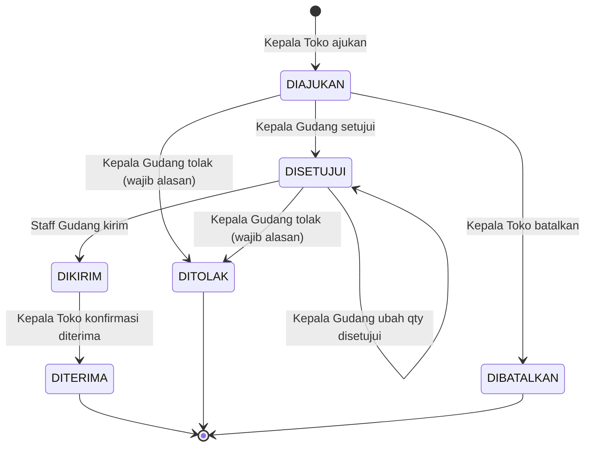

# Tahap 6 – Permintaan Toko dan Notifikasi

Tahap ini adalah **inti logika bisnis Stokara**: toko meminta barang, gudang menyetujui dan mengirim, toko mengonfirmasi. Notifikasi lonceng juga dibuat di sini, karena notifikasi muncul dari perubahan status permintaan.

## Alur status



## Aturan bisnis dan di mana ditulis

Semua aturan ada di **`app/models/permintaan.py`** (lapisan Model), bukan di route atau JavaScript.

| No | Aturan | Fungsi |
|---|---|---|
| 1 | Qty disetujui ≤ qty diminta **dan** ≤ stok tersedia | `cek_qty_disetujui()` |
| 2 | Kalau semua qty disetujui 0 → harus pakai **Tolak** | `cek_qty_disetujui()` |
| 3 | **Tidak ada pengiriman sebagian**: qty dikirim selalu = qty disetujui | `kirim()` |
| 4 | Kalau stok fisik kurang saat akan dikirim → **pengiriman ditolak**, Kepala Gudang mengubah qty disetujui atau menolak | `kirim()` |
| 5 | **Batal** hanya dari DIAJUKAN, oleh toko | `batalkan()` |
| 6 | **Tolak** dari DIAJUKAN atau DISETUJUI, **wajib alasan** | `tolak()` + route `tolak` |
| 7 | Stok yang sudah dipesan **kembali tersedia** saat permintaan DISETUJUI ditolak | otomatis lewat `qty_dipesan()` (tahap 5) |
| 8 | Kepala Toko hanya bisa melihat dan mengubah **permintaan tokonya sendiri** | `ambil_permintaan()` di route |
| 9 | Setiap perubahan status hanya berhasil kalau statusnya **masih sesuai** | `ubah_status()` |

### Contoh aturan 3 dan 4 (stok berubah antara disetujui dan dikirim)

```
Disetujui : Beras 5 (stok fisik saat itu 10)
Lalu      : ada beras rusak, stok fisik tinggal 3
Kirim     : DITOLAK → "Stok fisik tidak cukup untuk: Beras Premium 5kg (perlu 5, stok fisik 3).
                       Kepala Gudang perlu mengubah qty disetujui atau menolak permintaan ini."
            Status tetap DISETUJUI, tidak ada stok yang berkurang (minyak juga tidak dikirim).
Kepala Gudang ubah qty beras menjadi 3 → Kirim berhasil.
```

Kalau stok habis sama sekali, Kepala Gudang bisa **menolak** permintaan yang sudah disetujui, dengan alasan. Alasan itu dikirim ke toko lewat notifikasi.

## Kenapa `ubah_status()` memakai filter status?

```python
get_db().permintaan.update_one(
    {"_id": permintaan["_id"], "status": dari},   # hanya cocok kalau status MASIH "dari"
    {"$set": {"status": ke, ...}, "$push": {"riwayat": {...}}},
)
if hasil.matched_count == 0:
    raise ValidasiError("Status permintaan sudah berubah. Muat ulang halaman.")
```

Contoh: Staff Gudang tidak sengaja menekan **Kirim** dua kali. Klik pertama mengubah status menjadi DIKIRIM. Klik kedua mencari dokumen berstatus DISETUJUI, tidak menemukannya, lalu ditolak. Jadi stok hanya berkurang sekali (dibuktikan oleh `test_tidak_bisa_dikirim_dua_kali`).

## Urutan langkah saat Kirim

```
1. Periksa stok fisik SEMUA produk      → ada yang kurang? tolak, tidak ada yang berubah
2. Ubah status DISETUJUI → DIKIRIM      → mencegah pengiriman ganda
3. Kurangi stok per produk              → kurangi_stok() mencatat mutasi KELUAR
4. Kirim notifikasi ke toko
```

## Riwayat di dalam dokumen

Setiap perubahan status menambah satu baris ke `riwayat` (`$push`). Riwayat ini tampil di jendela detail:

```
Diajukan  · 19 Nov 2026 02.46 · Kepala Toko Salatiga 01   (Stok akhir pekan)
Disetujui · 19 Nov 2026 02.47 · Kepala Gudang Semarang
Dikirim   · 19 Nov 2026 02.47 · Staff Gudang Semarang
Diterima  · 19 Nov 2026 02.48 · Kepala Toko Salatiga 01
```

## API

| Method | URL | Role | Fungsi |
|---|---|---|---|
| GET | `/api/permintaan?status=` | KG, SG, KT | Daftar (Kepala Toko: hanya tokonya) |
| GET | `/api/permintaan/<id>` | KG, SG, KT | Detail (gudang mendapat angka stok, toko tidak) |
| GET | `/api/permintaan/pilihan-produk` | KT | Produk aktif untuk form |
| POST | `/api/permintaan` | KT | Ajukan |
| POST | `/api/permintaan/<id>/batal` | KT | Batalkan |
| POST | `/api/permintaan/<id>/terima` | KT | Konfirmasi diterima |
| POST | `/api/permintaan/<id>/setujui` | KG | Setujui, isi `{"items": [{"produk_id", "qty"}]}` |
| POST | `/api/permintaan/<id>/ubah-qty` | KG | Ubah qty disetujui |
| POST | `/api/permintaan/<id>/tolak` | KG | Tolak, isi `{"alasan": "..."}` |
| POST | `/api/permintaan/<id>/kirim` | SG | Kirim |

Permintaan toko lain menghasilkan **404**, bukan 403, supaya toko tidak tahu bahwa nomor itu ada.

## Notifikasi (lonceng)

| Kejadian | Penerima | Contoh |
|---|---|---|
| Diajukan | Kepala Gudang | Permintaan baru PRM-261119-0001 · Toko Salatiga 01 meminta 3 produk. |
| Dibatalkan | Kepala Gudang | PRM-... dibatalkan |
| Disetujui | Toko | PRM-... disetujui · Qty disesuaikan: 81 dari 100 yang diminta. |
| Disetujui | Staff Gudang | PRM-... siap dikirim |
| Qty diubah | Toko | Qty PRM-... diubah |
| Ditolak | Toko | PRM-... ditolak · Alasan: Stok Air Mineral 600ml kosong |
| Dikirim | Toko | PRM-... sudah dikirim |

Cara kerja:
- `app/models/notifikasi.py` menyimpan satu dokumen per notifikasi, ditujukan ke **role** (`untuk_role`) atau ke **toko** (`untuk_toko_id`).
- Siapa yang sudah membaca disimpan di `dibaca_oleh` (daftar id user), karena satu notifikasi role bisa dibaca beberapa orang.
- Lonceng mengambil `/api/notifikasi` setiap kali halaman dibuka. Angka kuning = jumlah yang belum dibaca.
- Klik notifikasi → membuka `/permintaan?nomor=PRM-...`, dan halaman langsung membuka jendela detail permintaan itu.

Keterbatasan: notifikasi tidak muncul seketika (*real-time*). Notifikasi baru terlihat saat halaman dibuka atau dimuat ulang. Vercel tidak mendukung koneksi yang terus terbuka (WebSocket); email atau WhatsApp masuk rencana pengembangan.

## Halaman Webix

| File | Isi |
|---|---|
| `permintaan_bersama.js` | Label status, label "Qty disesuaikan", jumlah qty, jendela detail. Dipakai dua halaman |
| `gudang/permintaan.js` | Kepala Gudang: kolom **Disetujui** bisa diketik (terisi otomatis = terkecil antara diminta dan tersedia), tombol Setujui / Simpan perubahan qty / Tolak. Staff Gudang: tombol Kirim |
| `toko/permintaan.js` | Form ajukan, tombol Batalkan / Konfirmasi diterima. Qty disetujui yang lebih kecil dari diminta berwarna kuning |
| `layout.js` | Lonceng (`view: "icon"` dengan `badge`) dan `popup` daftar notifikasi |

Komponen baru: `datatable` dengan `editable` (kolom yang bisa diketik), `webix.prompt` (dialog mengetik alasan, lewat `mintaTeks()`), `popup`, `list`, dan `badge`.

## Test (`tests/test_permintaan.py`, 21 test)

| Kelompok | Contoh test |
|---|---|
| Mengajukan | `test_diajukan_belum_mengurangi_stok_tersedia` |
| Menyetujui | `test_qty_disetujui_tidak_boleh_melebihi_stok_tersedia`, `test_stok_yang_sudah_dipesan_tidak_bisa_disetujui_lagi`, `test_toko_diberi_tahu_jika_qty_disesuaikan` |
| Menolak & membatalkan | `test_tolak_wajib_dengan_alasan`, `test_tolak_dari_disetujui_mengembalikan_stok_tersedia`, `test_batal_hanya_dari_diajukan` |
| Mengirim | `test_tidak_ada_pengiriman_sebagian`, `test_setelah_qty_diubah_pengiriman_berhasil`, `test_tidak_bisa_dikirim_dua_kali` |
| Hak akses | `test_kepala_toko_hanya_melihat_permintaan_tokonya`, `test_toko_tidak_melihat_angka_stok_gudang` |

Total test sekarang **78**.

## Keterbatasan (ditulis jujur di System Design)

- **Tanpa transaksi database.** Saat Kirim, status diubah dulu lalu stok dikurangi per produk. Kalau server mati tepat di tengah langkah 3, sebagian stok bisa belum berkurang. Kemungkinannya sangat kecil, dan riwayat mutasi membantu menemukannya. Pengembangan lanjut: MongoDB *multi-document transaction*.
- **Dua Kepala Gudang menyetujui bersamaan** bisa memesan stok sedikit melebihi yang tersedia. Dampaknya tertahan oleh aturan 4: pengiriman tetap dicek ke stok fisik.

## Cek pemahaman

1. Sebutkan perbedaan **Tolak** dan **Batal**: siapa yang melakukan, dari status apa, dan apakah wajib alasan?
2. Ceritakan apa yang terjadi kalau stok fisik berkurang setelah permintaan disetujui tetapi sebelum dikirim.
3. Kenapa `ubah_status()` menyertakan `"status": dari` di filter `update_one`?
4. Kenapa stok tersedia otomatis kembali saat permintaan DISETUJUI ditolak, padahal tidak ada kode yang "mengembalikan" stok?
5. Kenapa permintaan toko lain menghasilkan 404, bukan 403?
