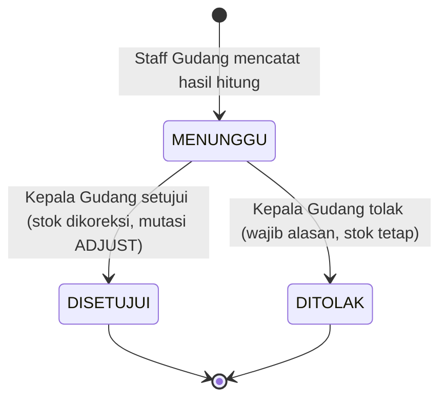

# Tahap 7 – Stock Opname

**Stock opname** = menghitung langsung barang di rak, lalu membandingkannya dengan stok di sistem. Selisih bisa muncul karena barang rusak, hilang, atau salah catat.

## Alur



| Langkah | Siapa | Yang terjadi |
|---|---|---|
| 1. Hitung | Staff Gudang | Isi kolom **Hitung fisik** per produk. Sistem mencatat stok sistem saat itu dan menghitung **selisih = hitung − sistem**. Stok **belum** berubah |
| 2. Periksa | Kepala Gudang | Mendapat notifikasi, membuka opname, melihat selisih per produk |
| 3a. Setujui | Kepala Gudang | Stok setiap produk **dikoreksi sebesar selisihnya**, otomatis tercatat sebagai mutasi **ADJUST** (Penyesuaian) |
| 3b. Tolak | Kepala Gudang | Wajib alasan. Stok tidak berubah, Staff Gudang menghitung ulang |

## Aturan bisnis (`app/models/opname.py`)

| No | Aturan | Alasan |
|---|---|---|
| 1 | Stok baru berubah **setelah disetujui** | Ada pemeriksaan kedua sebelum angka stok diubah |
| 2 | Yang dikoreksi adalah **selisihnya**, bukan menimpa dengan angka hitungan | Lihat contoh di bawah |
| 3 | Koreksi tidak boleh membuat stok **minus** | Sama seperti pengiriman (tahap 5) |
| 4 | Satu produk tidak boleh ada di **dua opname yang menunggu** | Supaya selisih yang sama tidak dikoreksi dua kali |
| 5 | Opname hanya bisa diperiksa **sekali** | Status difilter `MENUNGGU` saat diubah, seperti permintaan (tahap 6) |
| 6 | Tolak **wajib alasan** | Staff tahu apa yang perlu dihitung ulang |

### Contoh aturan 2: kenapa selisih, bukan angka hitungan?

```
09.00  Staff menghitung Minyak: sistem 50, di rak 47  → selisih −3 (3 botol bocor)
10.00  Barang masuk 20 botol                           → stok sistem 70
11.00  Kepala Gudang menyetujui opname

Kalau ditimpa angka hitungan : stok = 47   ✗ 20 botol yang baru masuk "hilang"
Dikoreksi sebesar selisih    : stok = 70 − 3 = 67   ✓
```

Fungsi yang dipakai adalah `koreksi_stok()` di `app/models/stok.py`. Fungsi ini menggantikan `sesuaikan_stok()` dari tahap 5:

```python
syarat = {"_id": produk_id}
if selisih < 0:
    syarat["stok"] = {"$gte": -selisih}   # tidak boleh minus
produk = find_one_and_update(syarat, {"$inc": {"stok": selisih}}, ...)
```

Polanya sama dengan `kurangi_stok()`: syarat dan perubahan dikerjakan MongoDB dalam satu langkah.

## API

| Method | URL | Role | Fungsi |
|---|---|---|---|
| GET | `/api/opname` | KG, SG | Daftar opname |
| GET | `/api/opname/produk` | SG | Produk aktif + stok sistem untuk form |
| POST | `/api/opname` | SG | Simpan hasil hitung, isi `{"catatan", "items": [{"produk_id", "qty"}]}` |
| POST | `/api/opname/<id>/setujui` | KG | Setujui dan koreksi stok |
| POST | `/api/opname/<id>/tolak` | KG | Tolak, isi `{"alasan"}` |

## Notifikasi

| Kejadian | Penerima |
|---|---|
| Hasil hitung disimpan | Kepala Gudang: "Opname OPN-... menunggu pemeriksaan · 2 produk dihitung, 1 ada selisih." |
| Disetujui / ditolak | Staff Gudang |

## Halaman Webix (`gudang/opname.js`)

- **Form Mulai Opname** (Staff Gudang): satu tabel berisi semua produk aktif. Kolom **Hitung fisik** bisa diketik (`editable`), dan kolom **Selisih** langsung berubah saat angka diketik (merah = kurang, hijau = lebih, "sesuai" = sama). Produk yang tidak dihitung dibiarkan kosong.
- **Jendela detail**: stok sistem, hasil hitung, dan selisih per produk. Kepala Gudang melihat tombol **Tolak** dan **Setujui & koreksi stok**.
- Riwayat stok di halaman **Stok Gudang** menampilkan koreksinya sebagai **Penyesuaian**, dengan referensi nomor opname.

Keterbatasan: stok sistem ditampilkan di form hitung. Dalam praktik terbaik (*blind count*), penghitung tidak melihat angka sistem supaya tidak terpengaruh. Ini bisa menjadi pengembangan lanjut.

## Test (`tests/test_opname.py`, 11 test)

| Test | Membuktikan |
|---|---|
| `test_hasil_hitung_mencatat_selisih_tanpa_mengubah_stok` | Aturan 1 |
| `test_disetujui_stok_dikoreksi_dan_tercatat_adjust` | Koreksi + mutasi ADJUST |
| `test_yang_dikoreksi_selisihnya_bukan_angka_hitungan` | Aturan 2 (contoh di atas: hasilnya 67) |
| `test_koreksi_yang_membuat_minus_ditolak` | Aturan 3 |
| `test_produk_yang_masih_menunggu_tidak_bisa_dihitung_lagi` | Aturan 4 |
| `test_tidak_bisa_disetujui_dua_kali` | Aturan 5 |
| `test_hak_akses_opname` | Staff tidak bisa menyetujui, Kepala Gudang tidak menghitung, toko tidak bisa membuka |

Ditambah `test_koreksi_stok_tidak_boleh_membuat_minus` di `test_stok.py`. Total test sekarang **90**.

## Cek pemahaman

1. Kenapa stok tidak langsung berubah saat Staff Gudang menyimpan hasil hitung?
2. Jelaskan dengan contoh kenapa yang dikoreksi adalah selisihnya.
3. Apa yang terjadi kalau satu produk dihitung di dua opname yang sama-sama menunggu, seandainya aturan 4 tidak ada?
4. Di mana koreksi opname terlihat setelah disetujui?
